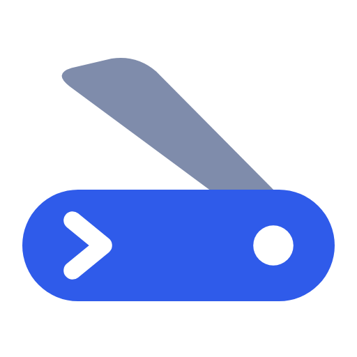

<p align="center">
  
</p>

<h1 align="center">Canidev Suíço</h1>

<p align="center">
Ferramentas online para desenvolvedores, em português e direto no navegador. <a href="https://canidevsuico.tec.br">canidevsuico.tec.br</a>
</p>

## Sobre

O Canidev Suíço é uma versão em português do Brasil, com visual próprio, do [IT Tools](https://github.com/CorentinTh/it-tools), projeto de código aberto criado por [Corentin Thomasset](https://corentin.tech). São mais de 80 ferramentas (formatar JSON, gerar UUID e hash, codificar Base64, testar regex, calcular sub-redes e outras) que rodam no navegador: o que você digita não é enviado a servidores.

## Desenvolvimento

Requer Node 18 (veja `.nvmrc`) e pnpm.

```sh
pnpm install   # instalar dependências
pnpm dev       # servidor de desenvolvimento
pnpm build     # checagem de tipos e build de produção (pasta dist/)
pnpm lint      # ESLint
pnpm vitest run --environment jsdom   # testes unitários
pnpm test:e2e  # testes Playwright
```

Os textos ficam em `locales/` (globais) e em `src/tools/<ferramenta>/locales/` (de cada ferramenta), com o vue-i18n. As cores do tema ficam em `src/palette.ts` e a marca em `src/assets/brand/`.

## Créditos

- Projeto original: [IT Tools](https://github.com/CorentinTh/it-tools), de [Corentin Thomasset](https://corentin.tech), e [todos os seus contribuidores](https://github.com/corentinth/it-tools/graphs/contributors).
- Fonte do logotipo: Noto Sans Display (SIL Open Font License), convertida em contorno.

## Licença

Este projeto, assim como o original, é distribuído sob a [GNU GPLv3](LICENSE).
